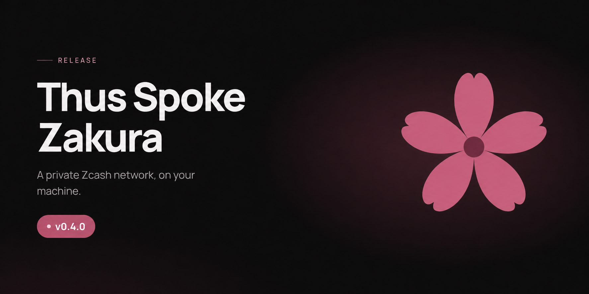

# Changelog

For earlier releases, see [GitHub Releases](https://github.com/zcashlabs/thus-spoke-zakura/releases).

## Unreleased

- **Zakura Common 4 migration:** The wallet uses Common 4.0.0 and backend/SQLite
  0.1.0-rc9.4 with Zakura 1.7.0. The declared Rust minimum rises to 1.97;
  the development and release toolchain remains 1.98.0. Wallet databases migrate
  forward on open. Retained signed payments keep their original transaction
  bytes, expiry, activity, and idempotency key. Newly constructed ordinary NU7
  transactions use the SDK's 120-block expiry delta from the candidate inclusion
  height. Freshly confirmed Ironwood can need the next block's spend anchor:
  automatic Sends mine at most one prerequisite block and retry once, while
  manual and interval Sends wait. Existing treasury funds awaiting that anchor
  do not trigger reward discovery or shielding. Operations retain their existing
  pending statuses and keys. Downgrades require a consistent pre-upgrade snapshot
  of app and node state; no database downgrade compatibility is promised. Release validation
  must cover fresh and retained wallets before publishing this coordinated set.
  No new Sapling migration scenarios are included in this change.
  [#436](https://github.com/zcashlabs/thus-spoke-zakura/issues/436)

- **Docker failures name the failed command:** A Docker invocation that exited
  nonzero without printing anything produced an empty error message, so a
  launcher read that goes through Docker could report a blank reason with no
  indication of which command had failed. The failed command and its exit
  status are now always included, and Docker's own stderr is still retained
  when it has something to say.
  [#370](https://github.com/zcashlabs/thus-spoke-zakura/issues/370)
- **Wallet quotes from the CLI:** `ths wallet quote --from <N> --source-pool
  <POOL> --destination-pool <POOL>` prints an account's spendable funds, fee,
  and maximum send for one pool route without sending, with integer zatoshi
  fields under `--json`.
  [#294](https://github.com/zcashlabs/thus-spoke-zakura/issues/294)

## v0.4.1

This patch release stops the launcher from trusting the compromised eMudhra
certificate authorities. It also fixes Ironwood-only sends, transparent spends
made by another wallet, CLI payment retries, interrupted startup, and several
dashboard forms.

### Action required

- **Security update:** Update to v0.4.1. Earlier launchers trust TLS
  certificates issued through eight compromised eMudhra intermediate CAs when
  they check GitHub for a new release; v0.4.1 rejects them. The dashboard,
  APIs, and Regtest services make no internet TLS connections and were not
  affected. [#423](https://github.com/zcashlabs/thus-spoke-zakura/pull/423)
- **Before installing or updating:** The installer and `ths update` download
  releases with your system `curl`, which uses the operating system's trust
  store rather than the launcher's. Update your OS or `ca-certificates` package
  first. On macOS, `/usr/bin/curl` still trusted the affected certificates when
  this release was prepared; the
  [eMudhra disclosure](https://emudhra.we-have-a-problem.com/) describes a
  workaround. To check an archive without relying on TLS, run
  `gh attestation verify <archive> --repo zcashlabs/thus-spoke-zakura`.

### Fixes

- **Wallet:** A fixed-amount send from Ironwood spends only Ironwood notes
  instead of falling back to Sapling funds. Transparent funds spent by another
  wallet client for the same account no longer stay in the balance.
  [#402](https://github.com/zcashlabs/thus-spoke-zakura/pull/402),
  [#396](https://github.com/zcashlabs/thus-spoke-zakura/pull/396)
- **CLI payments:** `ths wallet send`, `ths faucet`, and `ths wallet faucet`
  keep their idempotency keys until the result is printed, so a retry after an
  output failure resumes the same payment instead of making another.
  [#395](https://github.com/zcashlabs/thus-spoke-zakura/pull/395)
- **Startup recovery:** `ths stop` and `ths start` recover an instance whose
  network or volume create was interrupted.
  [#419](https://github.com/zcashlabs/thus-spoke-zakura/pull/419)
- **Dashboard:** Closing Send while its fee quote is pending no longer submits
  the payment. Send and Request reject amounts above 21,000,000 ZEC, and Mine
  stays usable when the browser blocks `sessionStorage`. Address pages reject
  non-integer balances instead of crashing, theme changes in another tab apply
  immediately, and block transaction columns stay aligned on mobile.
  [#275](https://github.com/zcashlabs/thus-spoke-zakura/pull/275),
  [#327](https://github.com/zcashlabs/thus-spoke-zakura/pull/327),
  [#363](https://github.com/zcashlabs/thus-spoke-zakura/pull/363),
  [#342](https://github.com/zcashlabs/thus-spoke-zakura/pull/342),
  [#334](https://github.com/zcashlabs/thus-spoke-zakura/pull/334),
  [#389](https://github.com/zcashlabs/thus-spoke-zakura/pull/389)

### Project updates

- **Maintainability:** Redundant Rust tests and a 122-second sleep are removed
  from CI. Shutdown polling no longer discards a notice that another command
  deleted the environment, a latent hazard with no current caller.
  [#421](https://github.com/zcashlabs/thus-spoke-zakura/pull/421),
  [#416](https://github.com/zcashlabs/thus-spoke-zakura/pull/416)

### Credits and comparison

- **Contributors:** Thank you to @AkshatGada, @MayurK-cmd, @megabyte0x,
  @mexes20, @Not-Sarthak, @RajeshRk18, @Shiva953, @tanctl, and @zeeshan8281.
- **Full changelog:** [Compare v0.4.0 with v0.4.1](https://github.com/zcashlabs/thus-spoke-zakura/compare/v0.4.0...v0.4.1).

## v0.4.0

This release makes payments durable and recoverable, activates NU7 for fresh
Regtest environments, and expands the dashboard and CLI for payment, mining,
and environment workflows.

### Action required

- **Fresh NU7 environment:** New instances activate NU7 at height 1. Existing
  chains keep their upgrade schedule, so create a fresh named instance to use
  NU7. [#132](https://github.com/zcashlabs/thus-spoke-zakura/pull/132)
- **Payment API:** A successful payment POST now means the request was durably
  accepted, not completed. Follow its `Location` and read `pending`,
  `confirmed`, or `failed`. After `ths reorg` or `ths rollback`, also accept
  `unconfirmed`; the payment is kept but not rebroadcast.
  [#235](https://github.com/zcashlabs/thus-spoke-zakura/pull/235),
  [#307](https://github.com/zcashlabs/thus-spoke-zakura/pull/307)
- **Address faucet key:** `POST /api/v1/faucet/address` requires an
  `idempotency_key` of 8–128 visible ASCII characters and returns HTTP 400
  without one. [#151](https://github.com/zcashlabs/thus-spoke-zakura/pull/151)
- **Activity API:** `GET /api/v1/activity` returns canonical wallet history.
  Accept the `transaction` kind, `null` `source_pool`, `destination_pool`, and
  `created_at`, and use the plural pool and account fields for multi-pool or
  multi-account transactions.
  [#361](https://github.com/zcashlabs/thus-spoke-zakura/pull/361)
- **Scripts:** `ths status` exits nonzero unless every service is running, and
  `ths doctor --json` exits nonzero when Docker is unreachable. `ths run`
  assigns free ports, so its child must read the exported endpoint variables.
  `ths mine --json` prints a mining job instead of `{blocks, hashes}`.
  [#376](https://github.com/zcashlabs/thus-spoke-zakura/pull/376),
  [#203](https://github.com/zcashlabs/thus-spoke-zakura/pull/203),
  [#310](https://github.com/zcashlabs/thus-spoke-zakura/pull/310),
  [#214](https://github.com/zcashlabs/thus-spoke-zakura/pull/214)

### Highlights

- **Durable payments:** Sends and faucets are stored before execution and
  progressed by the server. The dashboard and CLI keep idempotency keys and
  restore outcomes after interruption.
  [#199](https://github.com/zcashlabs/thus-spoke-zakura/pull/199),
  [#200](https://github.com/zcashlabs/thus-spoke-zakura/pull/200),
  [#211](https://github.com/zcashlabs/thus-spoke-zakura/pull/211),
  [#213](https://github.com/zcashlabs/thus-spoke-zakura/pull/213),
  [#217](https://github.com/zcashlabs/thus-spoke-zakura/pull/217),
  [#219](https://github.com/zcashlabs/thus-spoke-zakura/pull/219),
  [#235](https://github.com/zcashlabs/thus-spoke-zakura/pull/235),
  [#243](https://github.com/zcashlabs/thus-spoke-zakura/pull/243)
- **Payment requests and external addresses:** The dashboard creates ZIP-321
  requests with a QR code and can send or faucet to external Regtest addresses.
  [#110](https://github.com/zcashlabs/thus-spoke-zakura/pull/110),
  [#210](https://github.com/zcashlabs/thus-spoke-zakura/pull/210),
  [#384](https://github.com/zcashlabs/thus-spoke-zakura/pull/384)
- **Canonical wallet history:** Activity lists each transaction once with every
  affected account, pool, and memo; treasury outputs stay hidden.
  [#361](https://github.com/zcashlabs/thus-spoke-zakura/pull/361)
- **New CLI commands:** `ths wallet balances`, `ths wallet activity`, `ths tx`,
  `ths block`, and `--max` for `send`, `shield`, and `unshield`.
  [#188](https://github.com/zcashlabs/thus-spoke-zakura/pull/188),
  [#215](https://github.com/zcashlabs/thus-spoke-zakura/pull/215),
  [#244](https://github.com/zcashlabs/thus-spoke-zakura/pull/244),
  [#324](https://github.com/zcashlabs/thus-spoke-zakura/pull/324)
- **Reorg and rollback:** `ths reorg --depth N [--keep-txs]` replaces recent
  blocks and `ths rollback --depth N` removes them. Both have HTTP APIs and
  reconcile wallet balances.
  [#307](https://github.com/zcashlabs/thus-spoke-zakura/pull/307),
  [#388](https://github.com/zcashlabs/thus-spoke-zakura/pull/388),
  [#397](https://github.com/zcashlabs/thus-spoke-zakura/pull/397)
- **NU7 and mining jobs:** Fresh environments activate NU7 at height 1. `ths
  mine` follows server-owned jobs, so an interrupted client does not start
  duplicate work.
  [#132](https://github.com/zcashlabs/thus-spoke-zakura/pull/132),
  [#214](https://github.com/zcashlabs/thus-spoke-zakura/pull/214)
- **Environment workflows:** `ths run` runs a command against a fresh, isolated
  environment and cleans it up. `ths list` shows status, `ths logs` accepts
  `--head` and `--tail`, and `ths endpoints --env` prints shell exports.
  [#76](https://github.com/zcashlabs/thus-spoke-zakura/pull/76),
  [#101](https://github.com/zcashlabs/thus-spoke-zakura/pull/101),
  [#141](https://github.com/zcashlabs/thus-spoke-zakura/pull/141),
  [#311](https://github.com/zcashlabs/thus-spoke-zakura/pull/311),
  [#310](https://github.com/zcashlabs/thus-spoke-zakura/pull/310)

### Reliability, security, and usability

- **Lifecycle:** One launcher owns each environment, startup and cleanup are
  bounded and verified, and `ths wait` waits through startup. Environments
  started by v0.3.0 can be stopped, restarted, or reset after upgrading.
  [#133](https://github.com/zcashlabs/thus-spoke-zakura/pull/133),
  [#202](https://github.com/zcashlabs/thus-spoke-zakura/pull/202),
  [#276](https://github.com/zcashlabs/thus-spoke-zakura/pull/276),
  [#277](https://github.com/zcashlabs/thus-spoke-zakura/pull/277),
  [#279](https://github.com/zcashlabs/thus-spoke-zakura/pull/279),
  [#401](https://github.com/zcashlabs/thus-spoke-zakura/pull/401)
- **Security and releases:** The app rejects non-loopback `Host` headers to
  block DNS rebinding, release workflows handle tags safely, and Linux launchers
  target an older glibc.
  [#218](https://github.com/zcashlabs/thus-spoke-zakura/pull/218),
  [#237](https://github.com/zcashlabs/thus-spoke-zakura/pull/237)
- **Runtime and launcher:** Health probes check lightwalletd as well as Zakura,
  and Zakura state lives in the chain volume. `update` and `uninstall` follow
  symlinks, `update --json` keeps stdout parseable, and `ths logs` exits cleanly
  on a closed pipe.
  [#296](https://github.com/zcashlabs/thus-spoke-zakura/pull/296),
  [#283](https://github.com/zcashlabs/thus-spoke-zakura/pull/283),
  [#323](https://github.com/zcashlabs/thus-spoke-zakura/pull/323),
  [#333](https://github.com/zcashlabs/thus-spoke-zakura/pull/333),
  [#343](https://github.com/zcashlabs/thus-spoke-zakura/pull/343)
- **API errors and validation:** Malformed requests return the API error
  envelope. Each account's payments run in admission order, so a send right
  after a faucet no longer fails. Fee quotes return HTTP 503 before the wallet
  has scanned. Zero-amount ZIP-321 URIs and transparent amounts below the
  54-zatoshi dust threshold return HTTP 400.
  [#285](https://github.com/zcashlabs/thus-spoke-zakura/pull/285),
  [#392](https://github.com/zcashlabs/thus-spoke-zakura/pull/392),
  [#299](https://github.com/zcashlabs/thus-spoke-zakura/pull/299),
  [#246](https://github.com/zcashlabs/thus-spoke-zakura/pull/246),
  [#280](https://github.com/zcashlabs/thus-spoke-zakura/pull/280)
- **Dashboard:** Node connectivity is shown separately from wallet readiness,
  queries refresh when the event stream reconnects, and navigation stays tied to
  the current action. Payment times are local, Mine stays available on mobile,
  and block counts accept decimal digits only.
  [#171](https://github.com/zcashlabs/thus-spoke-zakura/pull/171),
  [#289](https://github.com/zcashlabs/thus-spoke-zakura/pull/289),
  [#382](https://github.com/zcashlabs/thus-spoke-zakura/pull/382),
  [#385](https://github.com/zcashlabs/thus-spoke-zakura/pull/385),
  [#306](https://github.com/zcashlabs/thus-spoke-zakura/pull/306),
  [#321](https://github.com/zcashlabs/thus-spoke-zakura/pull/321),
  [#337](https://github.com/zcashlabs/thus-spoke-zakura/pull/337),
  [#314](https://github.com/zcashlabs/thus-spoke-zakura/pull/314),
  [#302](https://github.com/zcashlabs/thus-spoke-zakura/pull/302)
- **Explorer:** Search handles hashes and transparent addresses, fees appear
  only when verifiable, and older-block pages label the first block shown.
  [#129](https://github.com/zcashlabs/thus-spoke-zakura/pull/129),
  [#383](https://github.com/zcashlabs/thus-spoke-zakura/pull/383),
  [#336](https://github.com/zcashlabs/thus-spoke-zakura/pull/336)

### Project updates

- **Documentation:** A new book covers setup, accounts, payments, mining,
  operations, app integration, and troubleshooting.
  [#122](https://github.com/zcashlabs/thus-spoke-zakura/pull/122),
  [#390](https://github.com/zcashlabs/thus-spoke-zakura/pull/390),
  [#391](https://github.com/zcashlabs/thus-spoke-zakura/pull/391)
- **Maintainability:** The server, wallet, launcher, and dashboard are split
  into focused modules, and flaky lifecycle and memo tests are fixed.
  [#178](https://github.com/zcashlabs/thus-spoke-zakura/pull/178),
  [#183](https://github.com/zcashlabs/thus-spoke-zakura/pull/183),
  [#186](https://github.com/zcashlabs/thus-spoke-zakura/pull/186),
  [#190](https://github.com/zcashlabs/thus-spoke-zakura/pull/190),
  [#191](https://github.com/zcashlabs/thus-spoke-zakura/pull/191),
  [#192](https://github.com/zcashlabs/thus-spoke-zakura/pull/192),
  [#238](https://github.com/zcashlabs/thus-spoke-zakura/pull/238),
  [#322](https://github.com/zcashlabs/thus-spoke-zakura/pull/322),
  [#409](https://github.com/zcashlabs/thus-spoke-zakura/pull/409)

### Credits and comparison

- **Contributors:** Thank you to @AkshatGada, @amiabix, @AnmolBansalDEV,
  @Annkkitaaa, @guha-rahul, @jonwalch, @kaushikc44, @MayurK-cmd, @megabyte0x,
  @nikhilkumar1612, @Not-Sarthak, @od-hunter, @paoValle, @piatoss3612,
  @PraneshASP, @raizo07, @RajeshRk18, @RealAdii, @robertocarlous, @tanctl,
  @vkpatva, @yashgo0018, and @Yonkoo11.
- **Full changelog:** [Compare v0.3.0 with v0.4.0](https://github.com/zcashlabs/thus-spoke-zakura/compare/v0.3.0...v0.4.0).

## v0.3.0

This release brings Ironwood to the local Zcash Regtest environment, adds wallet
transfers from `ths`, and improves mining progress and payment recovery. It also
changes API values and runtime resource names.

### Action required

- **Fresh Regtest instance:** The new launcher uses `ths-*` Docker resources
  instead of `tsz-*` and does not migrate an existing chain or wallet. Save
  anything you need before stopping the old instance: stopping deletes its
  chain, wallet, keys, and volumes. Once v0.3.0 is published, official v0.2.1
  users can stop their instance, run `ths update`, and start a fresh one.
  Source-build users need to rebuild or reinstall.
  [#125](https://github.com/zcashlabs/thus-spoke-zakura/pull/125)
- **API migration:** Use `ironwood` instead of `orchard` for pool values, and
  read `ironwood_zatoshi` instead of `orchard_zatoshi` from `/api/v1/accounts`.
  Requests specifying the old `orchard` pool are rejected.
  [#124](https://github.com/zcashlabs/thus-spoke-zakura/pull/124),
  [#126](https://github.com/zcashlabs/thus-spoke-zakura/pull/126)
- **Configuration migration:** Rename custom `TSZ_*` installer, updater,
  server, and development settings to `THS_*`. Browser settings and Docker
  resources using the old names are not migrated automatically.
  [#125](https://github.com/zcashlabs/thus-spoke-zakura/pull/125)
- **Endpoint changes:** The default dashboard, Zakura RPC, P2P, and lightwalletd
  host ports are now `32805`, `18232`, `18233`, and `9067`, bound to
  `127.0.0.1`. Use `ths start --port-offset 10` for another instance. Startup
  reports an occupied port instead of choosing a different one.
  [#72](https://github.com/zcashlabs/thus-spoke-zakura/pull/72)
- **Development addresses:** Fresh instances derive their accounts from a
  fixed, public mnemonic, so addresses are repeatable. Addresses from older,
  randomly seeded instances should not be assumed to match. Never send real
  funds to these Regtest accounts.
  [#103](https://github.com/zcashlabs/thus-spoke-zakura/pull/103),
  [#104](https://github.com/zcashlabs/thus-spoke-zakura/pull/104),
  [#120](https://github.com/zcashlabs/thus-spoke-zakura/pull/120)

### Highlights

- **Ironwood support:** New Regtest chains activate NU6.1, NU6.2, and NU6.3 at
  height 1. The environment uses Zakura 1.6.0 and the updated Zakura wallet
  stack. Shielded wallet operations use Ironwood, and the explorer displays
  Ironwood actions and roots.
  [#124](https://github.com/zcashlabs/thus-spoke-zakura/pull/124),
  [#126](https://github.com/zcashlabs/thus-spoke-zakura/pull/126)
- **Wallet commands:** `ths wallet faucet`, `send`, `shield`, and `unshield`
  operate on development accounts 1–5. Sends to Ironwood can include an
  encrypted memo of up to 512 bytes. A transfer may use the same source and
  destination account when the pools differ; sending back to the same account
  and pool is rejected.
  [#81](https://github.com/zcashlabs/thus-spoke-zakura/pull/81),
  [#138](https://github.com/zcashlabs/thus-spoke-zakura/pull/138)
- **Fee-aware sending:** The dashboard quotes the fee before sending and offers
  a **Max** button that leaves room for it. An unaffordable send returns HTTP
  422 with the required and available amounts.
  [#97](https://github.com/zcashlabs/thus-spoke-zakura/pull/97)
- **Mining progress across tabs:** Mining runs as a server-owned job, allowing
  the dashboard to restore progress after navigation, refresh, or closing and
  reopening the tab. `ths mine` still waits for completion. An admitted job
  continues if the CLI client times out; check its status before requesting
  another. Job history lasts for the server process and is discarded when it
  stops. [#139](https://github.com/zcashlabs/thus-spoke-zakura/pull/139)
- **Viewing key export:** `/api/v1/accounts` includes unified full viewing keys
  for user accounts 1–5. It does not expose the treasury account or spending
  keys. [#80](https://github.com/zcashlabs/thus-spoke-zakura/pull/80)

### Reliability and performance

- **Payment retries:** The server reserves idempotency keys before payment side
  effects and recovers prepared transactions across retries and restarts.
  Reusing a key with different payment parameters is rejected.
  [#71](https://github.com/zcashlabs/thus-spoke-zakura/pull/71)
- **Activity confirmation:** Payments are marked confirmed from chain evidence.
  Pending activity is reconciled after synchronization, startup, mining trouble,
  and retries. [#69](https://github.com/zcashlabs/thus-spoke-zakura/pull/69)
- **Scalable treasury synchronization:** The treasury is also the mining
  address, so every mined block adds another transparent output. Previously,
  routine wallet sync repeatedly loaded the treasury's entire unspent output
  set, making sync more expensive as the chain grew. Routine sync now refreshes
  transparent outputs for user accounts 1–5; when the faucet needs funds, it
  discovers treasury rewards block by block using a saved cursor. Reward
  imports and cursor updates commit together and rewind on a chain
  reorganization. Shielded scanning still covers all accounts, and the mining
  and faucet APIs are unchanged.
  [#114](https://github.com/zcashlabs/thus-spoke-zakura/pull/114)
- **Service timeouts:** Ordinary Zakura RPC calls and lightwalletd broadcasts
  have 30-second timeouts. Block generation has a separate, longer limit.
  [#77](https://github.com/zcashlabs/thus-spoke-zakura/pull/77),
  [#100](https://github.com/zcashlabs/thus-spoke-zakura/pull/100)
- **Explorer refresh and errors:** Open block, transaction, and address views
  refresh as the chain changes. Missing blocks and transactions return HTTP
  404; invalid Regtest transparent addresses return HTTP 400.
  [#107](https://github.com/zcashlabs/thus-spoke-zakura/pull/107),
  [#117](https://github.com/zcashlabs/thus-spoke-zakura/pull/117),
  [#88](https://github.com/zcashlabs/thus-spoke-zakura/pull/88)
- **Explorer layout:** Wide tables scroll within the explorer, and row
  animations no longer cause scrollbar flicker.
  [#70](https://github.com/zcashlabs/thus-spoke-zakura/pull/70)
- **Instance status:** Counting accounts no longer requires deriving wallet
  keys, and a stopped instance is no longer reported as ready.
  [#102](https://github.com/zcashlabs/thus-spoke-zakura/pull/102),
  [#108](https://github.com/zcashlabs/thus-spoke-zakura/pull/108)

### Project updates

- **Developer documentation:** The repository adds a detailed CLI reference,
  contributor guidance, and issue and pull request templates.
  [#81](https://github.com/zcashlabs/thus-spoke-zakura/pull/81),
  [#82](https://github.com/zcashlabs/thus-spoke-zakura/pull/82),
  [#95](https://github.com/zcashlabs/thus-spoke-zakura/pull/95)
- **License metadata:** The project and package metadata now identify MIT as
  the license. [#87](https://github.com/zcashlabs/thus-spoke-zakura/pull/87)

### Credits and comparison

- **Contributors:** Thank you to @AnmolBansalDEV, @Not-Sarthak, @PraneshASP,
  @USCMig, @amiabix, @bajpai244, @guha-rahul, @megabyte0x, @naz3eh,
  @0xpierre-dev, @piatoss3612, @tanctl, and @vkpatva.
- **Full changelog:** [Compare v0.2.1 with v0.3.0](https://github.com/zcashlabs/thus-spoke-zakura/compare/v0.2.1...v0.3.0).
