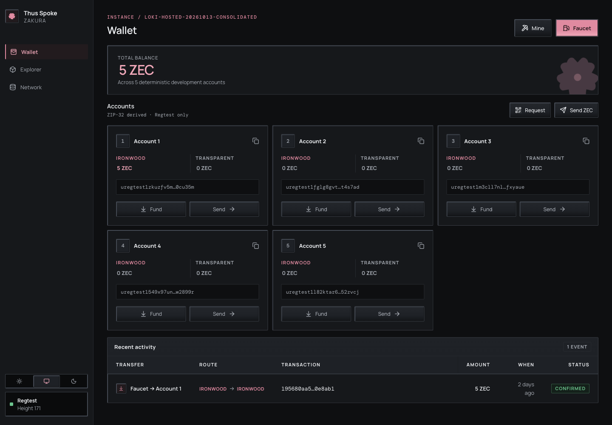

# Thus Spoke Zakura 🌸

Run a disposable Zcash Regtest network on your machine. `ths` starts Zakura,
lightwalletd, and a wallet-backed dashboard in Docker.



> [!WARNING]
> Regtest only. Test coins have no value, and development keys are public.
> Never send real funds to an address generated by this environment.

## Install and start

On macOS or Linux (Intel or ARM), start Docker Desktop or Docker Engine. Run
`docker version` and check that the **Server** section responds without `sudo`.
Then install the launcher and start an instance:

```console
curl --proto '=https' --tlsv1.2 -fsSL https://raw.githubusercontent.com/zcashlabs/thus-spoke-zakura/main/install.sh | sh
ths
```

Startup may take a few minutes while the chain and wallet are prepared.
When `ths` prints `default is ready`, it opens the dashboard. Keep that terminal
open while you use the instance.

## Try a payment

Open **Wallet**. Account 1 starts with 5 Ironwood ZEC; the other four accounts
start empty. Select **Fund** on Account 2, choose **Transparent** and 1 ZEC,
then select **Add funds**. Select **Send ZEC** to move 1 Ironwood ZEC from
Account 1 to Account 2. The app mines blocks to confirm both payments. Check
**Recent activity** for the result; balances may take longer to update.

To use the terminal instead, run these commands against the same instance:

```console
ths wallet faucet --accounts 2 --amount 1 --pool transparent
ths wallet send --from 1 --to 2 --amount 1
```

Choose the dashboard steps **or** the commands for one payment of each kind.
Running both makes additional payments. For your own application, run
`ths endpoints --json` to get this instance's local API, Zakura RPC, and
lightwalletd addresses. `eval "$(ths endpoints --env)"` exports the same
variables `ths run` passes to its child. See
[Connect your application](book/connect-an-app.md) for the request format.

To test chain reorganizations, run `ths reorg --depth 3` to replace recent
blocks or `ths rollback --depth 3` to remove them. See the
[CLI reference](book/cli.md) for limits and transaction retention options.

## Stop and clean up

Press Ctrl+C in the terminal running `ths`. It attempts to delete that
instance's containers, chain, keys, and wallet data. Check the command result:
if cleanup fails, keep any recovery files that exist and follow the
[troubleshooting guide](book/troubleshooting.md).

## Documentation

- [Read the book](book/README.md)
- [Getting started](book/getting-started.md)
- [Fund and send](book/using-the-dashboard.md)
- [Connect your application and use the API](book/connect-an-app.md)
- [CLI reference](book/cli.md)
- [Develop from source and run tests](book/development.md)
- [Troubleshooting](book/troubleshooting.md)

[Contributing](CONTRIBUTING.md) · [Releases](https://github.com/zcashlabs/thus-spoke-zakura/releases) · [MIT license](LICENSE)
