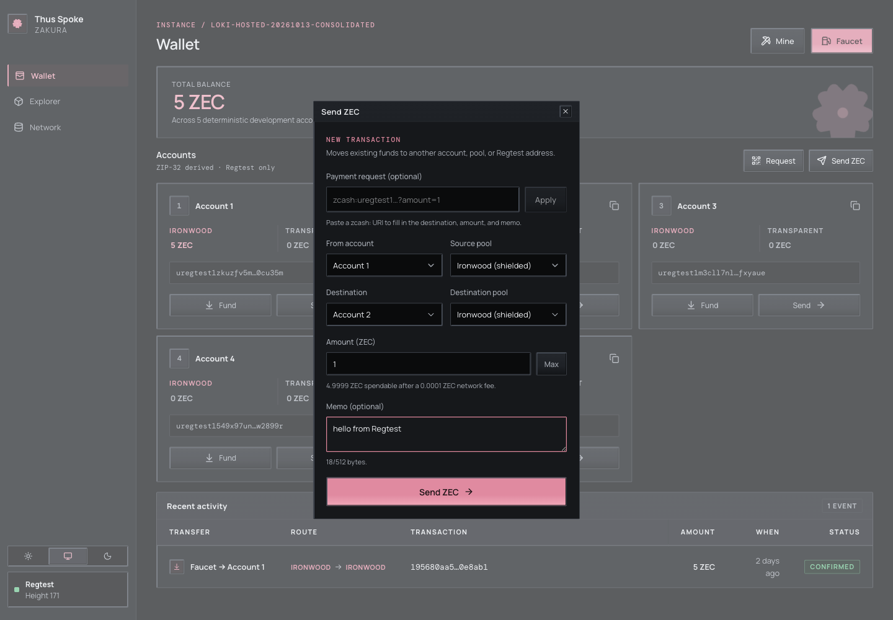

# Thus Spoke Zakura 🌸

Run a complete, private Zcash development network on your computer.

## Documentation

**[Read the book →](https://amiabix.github.io/thus-spoke-zakura-book/)**

It covers starting an instance, what each component owns, accounts and pools,
funding and sending, mining and wallet synchronization, what an API response
proves after a lost one, and connecting your own application. There is a
[`ths` command reference](https://amiabix.github.io/thus-spoke-zakura-book/cli.html),
a [guide to building from source](https://amiabix.github.io/thus-spoke-zakura-book/development.html),
and a [troubleshooting appendix](https://amiabix.github.io/thus-spoke-zakura-book/troubleshooting.html).
The sources live in [`book/`](book/README.md).

Every page is also served as markdown for tools that read rather than browse:
append `.md` instead of `.html` to any page,
[`book.md`](https://amiabix.github.io/thus-spoke-zakura-book/book.md) is the
whole book in one file, and
[`llms.txt`](https://amiabix.github.io/thus-spoke-zakura-book/llms.txt) indexes
both.

Thus Spoke Zakura starts everything you need for local experiments:

- a Zakura node on Regtest;
- five disposable development accounts;
- a faucet for creating test ZEC;
- automatic mining;
- lightwalletd and JSON-RPC endpoints; and
- a browser wallet, block explorer, and network dashboard.

Nothing connects to Zcash mainnet or testnet. Every run begins with a fresh
chain, and pressing Ctrl+C deletes the containers and development data.

Startup and shutdown are sums of separate phases, not one short HTTP timeout.
Each readiness phase allows 120 seconds. A single health or RPC attempt,
including a stalled connection or body, allows 2 seconds plus a short scheduling
delay for cancellation. Ordinary finite startup commands allow 30 seconds.
Attached initialization allows 120 seconds. Cleanup then gets its own 120
seconds, even if startup was already cancelled. Killing the `docker` process
does not cancel work the daemon has already accepted.

If cleanup cannot prove that this instance's resources, helpers, and metadata
are gone, the command fails. It keeps `lifecycle-recovery.json` and any
remaining `instance.json` so the instance can be identified. Do not delete
those files by hand, retry a create whose result is unknown, or prune shared
Docker state.

A failed `docker start`, or a failed inspection after `docker create` returns
an original container ID, can be recovered: cleanup validates ownership, removes
that ID, proves its absence, and persists the create or start's resolution before
deleting its wallet volumes and network. A later start can allocate fresh
resources under the same instance name. Cleanup does not retry the failed
mutation or turn the original launch error into success. A create or start
without a trustworthy original ID remains uncertain and keeps its dependencies
and recovery state. Same-name replacements are not adopted; shared unresolved
dependencies remain protected. Existing recovery journals with a known container
ID can be reconciled without changing their format.

The recovery journal records resources by kind and name and retains their
allocation identities. A per-name lock serializes startup, stop, and reset.
`run` holds that lock until cleanup; foreground start releases it once ready.
A second per-name lock is held by `start` or `run` until it exits, so another
`start` or `run` with the same name is refused instead of replacing the
running environment. While that launcher runs, `stop` and `reset --force` ask
it to shut down, as Ctrl+C would, during startup, once ready, or while `run`'s
command runs. They wait for its cleanup and then verify that nothing is left.
Requests name the launcher's session, so a leftover request cannot stop a
later launcher. A launcher stopped before it was ready exits with an error.
Without a running launcher, `stop` and `reset --force` delete what is left
themselves. The foreground launcher also watches the allocated app container
and exits when it is deleted some other way, without deleting the environment
again.


## Get started

### 1. Install Docker Desktop

Install [Docker Desktop](https://www.docker.com/products/docker-desktop/) on
macOS or Linux, then check that Docker is running:

```console
docker version
```

Both the `Client` and `Server` sections should appear without `sudo`.

### 2. Install Thus Spoke Zakura

```console
curl --proto '=https' --tlsv1.2 -fsSL https://raw.githubusercontent.com/zcashlabs/thus-spoke-zakura/main/install.sh | sh
```

The installer supports Linux and macOS on Intel and ARM. It verifies the
download and pulls the matching runtime images. The installed command is `ths`.

### 3. Start it

```console
ths
```

The first start can take a little longer while Docker prepares the images.
When the environment is ready, the dashboard opens automatically. Zakura's RPC
tip and the dashboard each have 120 seconds to become ready. Ordinary Docker
commands during startup have 30 seconds, and attached initialization has 120
seconds.

Keep this terminal open. Press Ctrl+C when you are finished. The launcher then
uses a separate 120 second cleanup allowance to stop the environment and delete
its chain, wallets, keys, volumes, and containers. That allowance is not
restarted by the shutdown signal. An incomplete or uncertain cleanup is a
failed command and leaves `lifecycle-recovery.json` beside any remaining
`instance.json`.

## What can I do?

### Create test funds

Open **Wallet**, select **Faucet**, choose an account and amount, and select
**Add funds**. The faucet creates disposable Regtest ZEC and mines the block
needed to confirm it.


Faucet requests are limited to 5 ZEC. These coins have no value and work only
inside this local environment.

From a terminal, fund several accounts at once by index:

```console
ths wallet faucet --accounts 1,2,3 --amount 3
```

### Send ZEC between accounts

Select **Send ZEC** or the **Send** button on an account card. Choose the source
account, destination account, pool, and amount. The resulting transaction is
mined automatically and appears under **Recent activity**.

You can use Ironwood or transparent balances to exercise different transaction
routes.

When the destination pool is Ironwood, you can add an optional memo of up to
512 bytes. It is encrypted to the recipient and never shown in the explorer.
Transparent outputs cannot carry a memo, so the field is disabled for them.



The Send dialog also accepts a Regtest address or a single-payment ZIP-321 URI.
Apply an edited URI, or clear it, before sending. Wallet's **Request** button
creates a copyable URI and QR code for a development account without moving
funds. See the book's [payment request walkthrough](https://amiabix.github.io/thus-spoke-zakura-book/using-the-dashboard.html#payment-request)
and [API reference](https://amiabix.github.io/thus-spoke-zakura-book/connect-an-app.html#the-rest-of-the-api-surface).

The same transfer from a terminal:

```console
ths wallet send --from 1 --to 2 --amount 1 --memo "rent for October"
```

`ths wallet send`, `ths wallet faucet`, and `ths faucet` save an idempotency key
for each request before they submit it, then wait up to 30 seconds for
confirmation. If a payment is still pending, its status is unknown, or you press
Ctrl+C, the command exits with an error and keeps the key. The environment keeps
processing the payment. Run the same command to check that payment again; it
does not create a second one. After the command reports a confirmed or failed
payment, the next identical command makes a new payment.

### Payment API compatibility

`POST /api/v1/send`, `POST /api/v1/faucet`, and
`POST /api/v1/faucet/address` durably accept an intent before execution. New or
unresolved payments return HTTP **202**; replays of stored `confirmed` or
`failed` payments return HTTP **200**. Every successful response includes the
existing operation body and a relative `Location` containing the exact encoded
idempotency key. The server continues execution after a client disconnects and
resumes retained intents after a restart.

This intentionally changes the API contract for scripts that previously assumed
a successful POST meant payment completion. Follow `Location` with **GET** to
observe execution. Activity lookup returns a one-item array, or `[]` when the
key is absent; address-faucet lookup returns an object, or HTTP 404. Status reads
use the local store and never start execution. The CLI and dashboard already
retain payment identity and show pending status; their resumption behavior above
remains the supported flow.

`preparing`, `prepared`, and `broadcast` are pending. Only `confirmed` and
`failed` are terminal. A pending operation can have an empty `txid` before its
signed transaction is retained. `last_error` is nullable: a pending dependency
error is recoverable and the server retries; successful progression clears it.
A completed Send preparation with insufficient funds can become `failed` only
when retained transaction reconciliation establishes that it cannot still pay.
Terminal failures retain their reason. A timeout is not a reason to create a
new key. A deliberately new payment after a terminal failure needs a new key.
Reusing a key with a changed request is rejected.

For example, this Bash script uses `curl` and `jq` to fund Account 2 with one ZEC.
Set `THS_API_URL` to the dashboard origin from `ths endpoints` (or run the script
through `ths run`). Keep the state directory to resume this same payment; choose
a new directory only for a deliberately new payment. It saves the request key
before POST, saves the returned operation and Location, and then polls only that
status URL. If admission's response is lost, rerunning submits the saved request
with the same key. Neither successful admission nor a mined block is confirmation.

```bash
#!/usr/bin/env bash
set -euo pipefail
: "${THS_API_URL:?Set THS_API_URL to the dashboard origin}"
payment_dir=${PAYMENT_DIR:-./faucet-payment}
mkdir -p "$payment_dir"
if [[ ! -s "$payment_dir/request.json" ]]; then
  key="script-faucet-$(uuidgen)"
  jq -n --arg key "$key" \
    '{account_id: 2, pool: "ironwood", amount_zatoshi: 100000000,
      idempotency_key: $key}' > "$payment_dir/request.json"
fi
if [[ ! -s "$payment_dir/location" ]]; then
  curl --fail-with-body --silent --show-error \
    -D "$payment_dir/headers" -o "$payment_dir/operation.json" \
    -H 'Content-Type: application/json' \
    --data-binary "@$payment_dir/request.json" \
    "${THS_API_URL%/}/api/v1/faucet"
  location=$(awk 'tolower($1) == "location:" {print $2}' \
    "$payment_dir/headers" | tr -d '\r')
  [[ -n "$location" ]] || { echo 'Admission returned no Location' >&2; exit 1; }
  printf '%s\n' "$location" > "$payment_dir/location"
fi
location=$(cat "$payment_dir/location")
while true; do
  curl --fail-with-body --silent --show-error \
    "${THS_API_URL%/}$location" > "$payment_dir/status.json"
  jq 'if type == "array" then .[0] else . end' \
    "$payment_dir/status.json" > "$payment_dir/operation.json"
  jq '{status, txid, last_error}' "$payment_dir/operation.json"
  status=$(jq -r '.status // "missing"' "$payment_dir/operation.json")
  case "$status" in
    confirmed) exit 0 ;;
    failed) exit 1 ;;
    preparing|prepared|broadcast) sleep 2 ;;
    *) echo 'Stored payment is missing or has an unknown status' >&2; exit 1 ;;
  esac
done
```

### Mine blocks

Select **Mine** from any dashboard page and enter the number of blocks. This is
useful when testing confirmations, expiry, coinbase maturity, or code that
reacts to new blocks.

Mining runs in the server. You can dismiss the dialog, navigate to another page,
refresh, or close the tab while it runs. The dashboard restores the latest job
and its confirmed progress when you return. Only one manual job can run at a
time, including wallet synchronization. Payment and faucet confirmation mining
can interleave; those blocks do not count toward the manual request.

Progress counts hashes acknowledged for this job. If a mining RPC fails, extra
blocks may have committed without a usable response. The dashboard then shows a
lower-bound count and uncertain progress; the server never automatically retries
that RPC. A wallet synchronization failure after mining reports the full mined
count separately from the synchronization error.

The dashboard uses these job endpoints:

| Endpoint | Behavior |
| --- | --- |
| `POST /api/v1/mining/jobs` | Accept `{blocks, idempotency_key}` and return the job with HTTP 202 |
| `GET /api/v1/mining/jobs` | Return `{job}` for the latest job, or `{job: null}` |
| `GET /api/v1/mining/jobs/{id}` | Return a retained job, or HTTP 404 |

Reusing an accepted key with the same block count returns the same job. A changed
count for that key or a different request during an active manual job returns
HTTP 409. The server retains at most 1,024 jobs and their keys for its process
lifetime. At capacity, it rejects new admissions with HTTP 503 while reads and
existing-key replays remain available. Stopping the server cancels running work
and discards the history; jobs are not recovered after restart.

`ths mine` submits through this same job API, printing progress as it polls
and reporting the confirmed count, the mined tip hash on completion, and the
job ID on any error. The idempotency key is saved to the instance directory
before the request goes out and only cleared once the job finishes, so a lost
or undecodable response, an interruption, or a 300-second polling timeout all
leave the key in place: the next `ths mine` with the same block count picks
the same job back up instead of starting a second one. Once a job finishes,
its key is forgotten, so repeating the command afterward starts a fresh job.
Each poll is capped at 2 seconds, so a single stalled request cannot delay
Ctrl+C or the overall deadline. `--json` keeps the `blocks` and `hashes`
fields from the legacy endpoint alongside the job's id, state, and progress.


### Explore blocks and transactions

The **Explorer** lists recent blocks. Search by block height, block hash,
transaction ID, or transparent address, then open an item to inspect its
details.


### Connect your own application

The default instance always binds loopback ports:

| Service | URL |
| --- | --- |
| Dashboard | `http://127.0.0.1:32805` |
| Zakura RPC | `http://127.0.0.1:18232` |
| lightwalletd | `http://127.0.0.1:9067` (Regtest, no TLS) |
| P2P | `127.0.0.1:18233` |

If a port is already taken, `ths start` exits and names that port. It does not pick a random host port.


```console
ths endpoints
ths endpoints --json
```

`endpoints --json` includes `"network": "regtest"` and `"tls": false` for lightwalletd.

### Use the development accounts

Every environment derives its accounts from the same mnemonic, so the account
addresses are the same on every run. The mnemonic is public; never send real
funds to these accounts.

```text
abandon abandon abandon abandon abandon abandon abandon abandon abandon abandon abandon abandon abandon abandon abandon abandon abandon abandon abandon abandon abandon abandon abandon art
```

| Account | Transparent address |
| --- | --- |
| 1 | `tmBsTi2xWTjUdEXnuTceL7fecEQKeWaPDJd` |
| 2 | `tmF3CKFqQ68GdisHK3D9S8pMty7a7Fr2wiN` |
| 3 | `tmRmiMusmfipcUmWeQ4YUVc6rKtckdd2aV3` |
| 4 | `tmDGByq79K3SJdCt3aGCTjYquv45Nf3ExaL` |
| 5 | `tmAsyD1UHXiomo6na1z7b1UtMSpFJArgPv9` |

Unified addresses:

```text
Account 1: uregtest1zkuzfv5m3yhv2j4fmvq5rjurkxenxyq8r7h4daun2zkznrjaa8ra8asgdm8wwgwjvlwwrxx7347r8w0ee6dqyw4rufw4wg9djwcr6frzkezmdw6dud3wsm99eany5r8wgsctlxquu009nzd6hsme2tcsk0v3sgjvxa70er7h27z5epr67p5q767s2z5gt88paru56mxpm6pwz0cu35m
Account 2: uregtest1fglg8gvt5luptyqvrx0u52yam4cru63skg9s0sa6zth72hachgyhwm8e7p9vy2vcatws7wvzfhnrqte4nwrff7tju4dv35gdn4h8ekarqyeqlk5gpmm5zlphzls960xe20cajd0k4vcvm2j8sekz77f864sgedncru8u8ruz8gvnpuxvnk7qcyszj7jg5n7nqqqfswh736c2kt4s7ad
Account 3: uregtest1m3cll7nlzq6dyrgpfvw22xcrvkq4x4y79q6wekj9t24dh6khunpu0gw7u80tlz047gwmr54qvhllq4ad4vm5qrxjlr997l3egt4scs3fg578stzue3u68rte0y76gy43kmvgvaj0jcmkewpa86w9ml2ph2wg9cd2mnwr272y8eggtvhsrxeeykx04hksanha3qmvhrf0v2c52fxyaue
Account 4: uregtest1549x97unhklahphm9rzvf9dl6fm8nnpw8upggjnet7090sf994wm8crdnv8ul4h4jwy07hdt9ns59307um2gqzzpfssphtwjj4053ykgc4w2kczq4u9gxg9t08eg8d7gj90wp84v34wyurfhvu4zpmrkl9le2m04jcletuwvwa52a9fj90v3wulh32yhldr84uwr4j47z3w55w2899r
Account 5: uregtest1l82ktar6wygqsncxp7famz8manh48tv283pve29fnumsrskyj9dyhn50l9gntm9k524cjq5xxm0zr7qwsspcmtrm5jlc7tqww60p9uvd8dke3sah86yzkj4rakhkpp0um6n08dxg50jv4pxnf3stenmyeyzqm0746g87sjh6kd328d0jetnwgktkuhjsfnhca5s9stselz02q52zvcj
```

### Run project commands against a settled environment

`ths run` creates a fresh environment, waits until Zakura, lightwalletd, and
the wallet agree on the chain tip, runs your command, then deletes the runtime
and its development data:

```console
ths run -- npm test
ths run --timeout 300 -- cargo test --test payments
```

If Docker cannot confirm a timed-out mutation, the launcher keeps a recovery
journal and reports the incomplete cleanup instead of deleting uncertain
resources.

Startup and settlement have a 120-second default timeout. The child command
has no runtime limit and receives `THS_INSTANCE`, `THS_NETWORK`, `THS_API_URL`,
`THS_ZAKURA_RPC_URL`, `THS_LIGHTWALLETD_URL`, `THS_LIGHTWALLETD_TLS`, and
`THS_P2P_ADDR`. Seeds and spending keys are not exported; projects that need
the deterministic development seed can use the explicit `POST /api/v1/dev/seed`
endpoint. `ths run` chooses a fresh `run-<UUID>` name unless `--name` is supplied and
refuses an existing environment. It uses the default loopback ports, so they
must be free. `ths run` supports non-interactive commands; commands that read from
the controlling terminal are not supported.

To wait for an environment you started separately:

```console
ths --name protocol wait --timeout 300
```

## Useful commands

Running `ths` with no command starts the default environment.

| Command | What it does |
| --- | --- |
| `ths` | Start a fresh environment and open the dashboard. Readiness is 120 seconds per phase, ordinary startup commands are 30 seconds, initialization is 120 seconds, and cleanup is a separate 120 seconds |
| `ths start --no-open` | Start without opening a browser, with the same phase budgets as `ths` |
| `ths --json start --no-open` | Print endpoints as JSON on stdout, with startup diagnostics on stderr |
| `ths start --port-offset 10` | Start on loopback ports shifted by 10 for another instance |
| `ths status` | Show health and endpoint information |
| `ths open` | Open the running dashboard |
| `ths endpoints --json` | Print endpoints for scripts and developer tools |
| `ths run -- npm test` | Run a command in a fresh, settled environment and delete it afterward |
| `ths --name protocol wait` | Wait for an existing environment to settle |
| `ths mine 10` | Mine blocks on the running environment and synchronize its wallet |
| `ths faucet <ADDRESS>` | Send 1 disposable ZEC to a Regtest unified or transparent address; repeat the same command to check a pending payment |
| `ths faucet <ADDRESS> --amount 2.5` | Send a custom amount of up to 5 disposable ZEC |
| `ths wallet balances` | Print each development account's balances and addresses |
| `ths wallet faucet --accounts 1,2,3 --amount 3` | Fund development accounts by index from the treasury; repeat the same command to check pending payments |
| `ths wallet send --from 1 --to 2 --amount 1 --memo "hi"` | Send between development accounts or pools, with an optional Ironwood memo; repeat the same command to check a pending payment |
| `ths wallet send --from 1 --to 2 --max` | Send the source pool's maximum spendable balance after the server-calculated fee |
| `ths wallet send --from 1 --uri "zcash:..."` | Pay a ZIP-321 payment URI to any Regtest address; repeat the same command to check a pending payment |
| `ths wallet activity --limit 20` | Print recent wallet transfers and faucet activity |
| `ths wallet shield --from 1 --to 2 --amount 0.5` | Spend transparent funds into the same or another account's Ironwood balance |
| `ths wallet unshield --from 1 --to 2 --amount 0.2` | Spend Ironwood funds into the same or another account's transparent balance |
| `ths logs app -f` | Follow dashboard/server logs |
| `ths logs zakura -f` | Follow node logs |
| `ths logs lightwalletd -f` | Follow lightwalletd logs |
| `ths logs --tail 200 -f` | Print the last 200 app log lines, then follow |
| `ths logs zakura --head 200` | Print the first 200 node log lines |
| `ths list` | List environments and their container status |
| `ths stop` | Stop and delete the environment after verified cleanup. Incomplete or uncertain cleanup fails and keeps `lifecycle-recovery.json` |
| `ths reset --force` | Force-delete one environment and all its data after verified cleanup. A failed cleanup keeps recovery metadata and does not prune other Docker resources |
| `ths doctor [--json]` | Check Docker and local configuration; exit nonzero if Docker is unreachable |
| `ths pull` | Pull the exact images for this launcher version |
| `ths update --check` | Check for a newer release |
| `ths update` | Install the latest verified release |
| `ths uninstall` | Remove the installed launcher executable |
| `ths completions bash\|zsh\|fish` | Print a shell completion script that covers every command and flag |

Everything under `ths wallet` acts on the development wallet held by the
running `ths` server. See [book/cli.md](book/cli.md) for the full command
reference, including every `ths wallet` option, memo rules, and more examples.

Every command accepts `--name` for isolated environments:

```console
ths --name alice
ths --name bob
ths --name alice mine 10
ths mine 10 --name alice
```

Each named environment has its own Docker resources. A second instance must
not reuse the default ports:

```console
ths --name alice start --port-offset 10
```

`--port-offset` is a multiple of 10 added to every default host port
(dashboard 32815, RPC 18242, P2P 18243, lightwalletd 9077). If those binds
are taken, start fails rather than remapping.

### Shell completions

`ths completions` prints a completion script for bash, zsh, or fish. The
script covers every command and flag. It does not start an environment.
Save it where your shell loads completions, then open a new terminal.

```console
# bash (requires the bash-completion package)
mkdir -p ~/.local/share/bash-completion/completions
ths completions bash > ~/.local/share/bash-completion/completions/ths

# zsh
mkdir -p ~/.zsh/completions
ths completions zsh > ~/.zsh/completions/_ths

# fish
mkdir -p ~/.config/fish/completions
ths completions fish > ~/.config/fish/completions/ths.fish
```

Zsh loads `~/.zsh/completions` only when that directory is on `fpath` before
`compinit`. Add this to `~/.zshrc` if it is not already there:

```zsh
fpath=(~/.zsh/completions $fpath)
autoload -U compinit
compinit
```

## Develop from source

You need Rust 1.98, Node 24, and Docker.

First install the web dependencies and build development runtime images:

```console
cd web
npm ci
cd ..
cargo run -p thus-spoke-zakura -- build --dev
```

Then run the launcher directly from the checkout:

```console
cargo run -p thus-spoke-zakura
```

Image building and starting are deliberately separate. After changing the
server or web app, rerun `build --dev`; the next start uses that new local
image. Use `build` without `--dev` to create release-optimized images.

Run the test suite with:

```console
cargo test --workspace
npm run lint --prefix web
npm test --prefix web
npm run build --prefix web
```

Docker-free tests do not start a daemon. These ignored launcher regressions
need a disposable Docker daemon and, for the lost-create and lost-start cases, the prepared
runtime images. Run one at a time:

```console
cargo test -p thus-spoke-zakura runtime::docker_lifecycle_tests::lost_start_reply_is_cleaned_up_and_can_be_retried -- --ignored --exact
cargo test -p thus-spoke-zakura runtime::docker_lifecycle_tests::lost_create_reply_retains_uncertainty_and_recovery -- --ignored --exact
cargo test -p thus-spoke-zakura runtime::docker_lifecycle_tests::lost_remove_reply_is_verified_against_daemon_state -- --ignored --exact
cargo test -p thus-spoke-zakura runtime::docker_lifecycle_tests::partial_cleanup_preserves_foreign_resources_and_other_instances -- --ignored --exact
```

### Activity-recovery integration test

The `activity-recovery` CI job runs the real recovery regression on Linux for
every push and pull request. It is separate from the normal Rust and web jobs:
`cargo test --workspace` is Docker-free and cannot establish that this live
scenario works.

Run the following from the repository root. It requires Rust 1.98.0, a running
Docker daemon, network access to pull `zakuracore/zakura:1.6.0`, and enough
local CPU, memory, and time to build the existing pinned lightwalletd image and
create a real Ironwood proof. The Rust Cargo integration target is the only test
runner: the normal Cargo invocation runs Docker-free helper tests while the
live test remains ignored until explicitly selected. The node and lightwalletd
remain real external services for that explicit invocation.

```console
cargo test --locked --profile dev-runtime -p ths-server --test activity_recovery --no-run
cargo test --locked --profile dev-runtime -p ths-server --test activity_recovery
# The preceding command runs helper tests; the live test remains ignored.
docker pull zakuracore/zakura:1.6.0
docker build -f docker/lightwalletd.Dockerfile -t ths-recovery-lightwalletd:local .
cargo test --locked --profile dev-runtime -p ths-server --test activity_recovery -- --ignored --exact startup_funding_retry_after_auto_mine_failure_has_one_payout
cargo test --locked --profile dev-runtime -p ths-server --test activity_recovery -- --ignored --exact broadcast_recovers_after_auto_mine_failure
cargo test --locked --profile dev-runtime -p ths-server --test activity_recovery -- --ignored --exact concurrent_identical_sends_have_one_chain_effect
cargo test --locked --profile dev-runtime -p ths-server --test activity_recovery -- --ignored --exact internal_address_faucets_record_confirmed_activity
cargo test --locked --profile dev-runtime -p ths-server --test activity_recovery -- --ignored --exact internal_address_faucet_recovers_after_auto_mine_failure
cargo test --locked --profile dev-runtime -p ths-server --test activity_recovery -- --ignored --exact external_address_faucet_behavior_is_unchanged
cargo test --locked --profile dev-runtime -p ths-server --test activity_recovery -- --ignored --exact same_account_cross_pool_round_trip_is_replay_safe
cargo test --locked --profile dev-runtime -p ths-server --test activity_recovery -- --ignored --exact queued_send_retry_survives_lost_response_and_restart
cargo test --locked --profile dev-runtime -p ths-server --test activity_recovery -- --ignored --exact queued_external_faucet_retry_survives_lost_response_and_restart
```

The first command compiles the integration target. The second runs its
Docker-free helper coverage and leaves the ignored live regression unexecuted.
The remaining Cargo commands explicitly select the live regressions; Cargo supplies that
target with the matching source-built `ths-server` binary, including when
`CARGO_TARGET_DIR` is set. Do not substitute an installed or older binary.

The live test owns a UUID-prefixed `ths-recovery-*` Docker network, containers,
and volumes, plus private temporary data/configuration directories, a local RPC
proxy, and a local server process. It sends a genuine 1,000,000-zatoshi (0.01
ZEC) Ironwood payment from Account 1 to Account 2, holds automatic
`generate([1])` requests behind a controlled proxy failure, mines directly
through the node, then waits for the production background progression loop to
update the existing activity row. The pending window checks an observed mining
failure and no forwarded automatic mine; autonomous retries may encounter the
same controlled failure. Direct mining and GET polling establish recovery
without another execution-triggering request. The startup funding regression
retains its separate one-shot mining failure.

The queued-retry regressions exercise Send and an external-address faucet through
the production HTTP handlers. A loopback proxy withholds the original HTTP
admission response until the client stops waiting. The server progresses the
retained intent to broadcast while controlled mining failures keep the original
transaction pending in the node's mempool. Controlled proxies then report that
transaction missing and substitute the exact lightwalletd already-queued
response during autonomous progression. These are injected faults, not a
naturally occurring node queue race. Same-key POST replay observes durable
admission; GET polling observes execution. Both server and wallet journals,
signed bytes, transaction identity, and reserved inputs must remain unchanged
and pending without a block hash. After restarting the server against both
existing databases, the tests mine the original and check canonical confirmation,
exactly one payout, and no additional broadcast or block on confirmed replay.

The same-account round-trip regression unshields 1,000,000 zatoshis from Account 1
to its transparent pool, then shields 500,000 zatoshis back to Ironwood. It checks
exact pool balances, Ironwood change, consumption of the received transparent
output, transaction inclusion, and persisted activity. Replaying each request
with the same idempotency key must leave balances, activity, and the chain tip
unchanged. The exact fee and change expectations belong to this controlled
single-note/single-UTXO fixture and pinned SDK.

This is an integration test, not a mocked proof: image pull/build, wallet
startup, and Ironwood proving make it materially slower and more resource-
intensive than the helper suite. Its fixture removes only exact resources it
registered, stops and reaps its child server, shuts down the proxy, and returns
nonzero for a timeout or cleanup failure. It never prunes shared Docker state.
It suppresses server process output and does not upload raw process logs,
request bodies, wallet keys, wallet databases, or configuration directories.

To prove the regression is sensitive, perform the negative control only after a
successful live run and only in an isolated verification worktree. Temporarily
remove the `background.spawn(async move { ... })` block that calls
`crate::payments::progression::payment_confirmation_loop(state)` from
`background_tasks` in `crates/ths-server/src/bootstrap.rs`, rerun the same explicit live Cargo command,
and require failure at background activity recovery after the broadcast,
intercepted auto-mine failure, and real inclusion checks. Restore the exact block
immediately, including after a failed run; do not retain the temporary
production-code edit.

## How it fits together

```text
Browser ──HTTP/SSE── ths-server ──JSON-RPC── Zakura (Regtest)
                         │                       │
                         └──────gRPC──── lightwalletd
```

The server owns wallet synchronization and exposes the latest confirmed wallet
snapshot to the dashboard. A separate supervised loop progresses durable
payment intents every two seconds, independently of wallet synchronization.
It resumes preparation, retained transaction submission, and canonical
confirmation fairly across account payments and external-address faucets,
including retained legacy transactions. The traversal remembers its collection
choice and cursors across passes, so one slow record does not always go first.
Periodic transaction lookups are bounded to two seconds and each dispatch has a
ten-second budget. Exhausting that budget stops new stages; an active wallet
preparation is awaited while serialization remains held. Ten seconds is not a
hard ceiling on proof construction. Unknown transactions and unavailable RPC
responses remain pending with recoverable errors available through status reads.

The server opens HTTP as soon as its local stores load, so stored payment status
stays readable while Zakura or lightwalletd is unavailable. Health reports ready,
and send, faucet, and mining requests are accepted, only after both dependencies
respond and Account 1 is funded. `GET /api/v1/activity?idempotency_key=<key>`
returns the matching payment as a one-item array, or `[]`.
`GET /api/v1/faucet/address?idempotency_key=<key>` returns the faucet payment,
or HTTP 404. Both read only the local store, and `last_error` is `null` unless the
payment has a recorded error.

A hidden sixth account acts as the mining and faucet
treasury. Account 1 starts with 5 Ironwood ZEC, so you can experiment immediately.

The local chain activates every network upgrade through NU7 at height 1.
NU7 applies a 25-second block target, shielded action limits, and transaction
fee recycling into the network sustainability mechanism (NSM). `ths mine`
still generates blocks on demand. Shielded funds live in the Ironwood
pool. The Orchard pool stopped accepting deposits at NU6.3, so the wallet API
rejects `orchard` as a pool.

The launcher chooses exact versioned images, labels every Docker resource by
instance, and never binds a service beyond loopback.

> [!WARNING]
> This project is for Regtest development only. Never send real funds to an
> address generated by Thus Spoke Zakura.

## Troubleshooting

**Docker permission denied on Linux**

```console
sudo usermod -aG docker "$USER"
```

Log out of your desktop session completely, log back in, and verify that `id`
includes the `docker` group. Docker group membership grants root-equivalent
access, so use it only for trusted users.

**The dashboard did not open**

```console
ths open
```

Or copy the Dashboard URL printed by the launcher.

**A service is unhealthy**

```console
ths status
ths logs app
ths logs zakura
ths logs lightwalletd
```

**Start over completely**

```console
ths reset --force
```

This permanently deletes that instance's development data when cleanup is
verified. If reset or stop fails and `lifecycle-recovery.json` is still in the
instance directory, cleanup could not prove the outcome. Keep that file and
any remaining `instance.json`. Do not remove them manually, do not repeat an
unknown create, and do not prune shared Docker data. A killed `docker` command
does not mean the daemon cancelled the request.

**Cleanup did not finish**

An incomplete cleanup still knows which of this instance's resources remain. An
uncertain cleanup does not, and uncertainty takes precedence when both apply.
The command exits nonzero either way. `lifecycle-recovery.json` is the record
of the unfinished mutations.

**Uninstall the launcher**

Stop any running environment with Ctrl+C, then run:

```console
ths uninstall
```

This removes only the installed `ths` executable. Cached Docker images and the
small launcher configuration directory remain available for a later reinstall.

## Releases

Release binaries and checksums are available on the
[GitHub Releases page](https://github.com/zcashlabs/thus-spoke-zakura/releases).
Maintainer instructions live in [RELEASING.md](RELEASING.md).

## License

MIT
