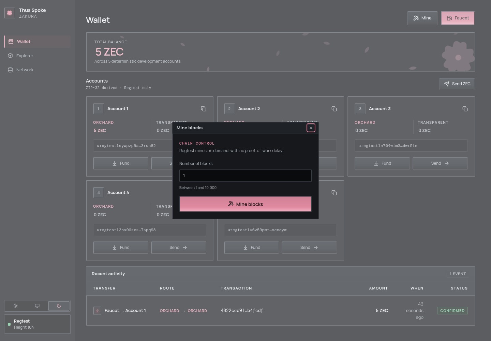

# 5. Mining and wallet sync

You have funded Account 2 and sent a payment. Both operations normally mine
a confirming block for you. This chapter mines explicitly and follows a
block from the node to the wallet and browser.

**Mining** asks Zakura to generate Regtest blocks on demand. A transaction is
**confirmed** when the node reports it in a block on its current chain with
a block hash. That does not instantly make every wallet view current:
lightwalletd still has to index the block, and the wallet still has to scan
and reconcile it.


1. `ths mine N` and the dashboard Mine dialog call
   `POST /api/v1/mining/jobs` with a block count and
   idempotency key; each receives HTTP **202** and a job before mining finishes.
   The server accepts **1–10,000** blocks.
2. Zakura generates blocks and returns their hashes. The server asks Zakura
   for the last returned block's height.
3. The wallet waits for lightwalletd to index that height, scans compact
   blocks, reconciles against Zakura's canonical block hashes, and publishes
   a fresh user-account snapshot at a matching checkpoint.
4. The server notifies dashboard clients of a `chain` update. After successful
   synchronization, the CLI returns `blocks` and `hashes`; the dashboard job
   becomes `completed`. If a step after generation fails, the CLI returns an
   error and the job becomes `failed`, even though blocks may already exist.

## Mine and inspect one result

In the second terminal from Chapter 1, mine two blocks:

```console
$ ths mine 2
2 of 2 blocks confirmed on default. Mining completed. Wallet synchronized. New tip: 9ef8f0064e3f088f2012fe04d5d70b42f00ae1e9676cdc3d5384ad31d384b8c4
```

The tip hash differs on every run. Regtest has no proof-of-work delay;
completion also waits for indexing and wallet scanning. The dashboard's
**Mine** dialog starts a job and shows its progress. Do not run both if you
intend to add only two blocks.



## Follow mining progress in the dashboard

The **Mine** dialog shows block-generation progress, then `syncing` while the
wallet catches up. A job becomes `completed` only after synchronization
succeeds; generation or synchronization errors leave it `failed`. Only one
manual job can be active, including its synchronization phase.


The dashboard reads `GET /api/v1/mining/jobs` for the latest job, or
`GET /api/v1/mining/jobs/{id}` for a specific job. Reusing an accepted key with
the same block count returns the same job within that server lifetime.

`ths mine` saves its key in the instance directory before submission and polls
for progress. A lost or undecodable response, interruption, or 300-second
polling timeout leaves the key in place. Rerun the command with the same block
count to resume that job. Once the job finishes, the CLI clears its key, so
repeating the command starts new mining. Each poll is capped at two seconds.
On completion, the CLI reports the confirmed count and mined tip hash; errors
include the job ID. `--json` includes the legacy `blocks` and `hashes` fields
alongside the job's ID, state, and progress.

Read the node and wallet view through the running instance's API:

```console
DASHBOARD_URL="$(ths endpoints --json | python3 -c 'import json,sys; print(json.load(sys.stdin)["dashboard"])')"
curl -fsS "$DASHBOARD_URL/api/v1/status"
curl -fsS "$DASHBOARD_URL/api/v1/accounts"
```

`ths status` reports container status and endpoints, not chain height. In
`GET /api/v1/status`, `node.blocks` is the node height and
`node.bestblockhash` is the tip hash.

The wallet fields mean:

| Field | Meaning |
| --- | --- |
| `wallet_sync.state` | `ready`, `syncing`, or `error` for the server's last synchronization attempt. |
| `observed_height` and `observed_hash` | The node checkpoint the server most recently observed. |
| `fully_scanned_height` and `fully_scanned_hash` | The wallet checkpoint it has scanned and validated; these can be null below the wallet birthday. |
| `error` | Why the last attempt failed, if it did. |
| `last_success_at` | Unix time of the last successful snapshot publication. |

After a successful `ths mine` on the normal running example, the wallet
has reconciled through the mined tip before the response. An independent
chain change can happen later, so use the current status fields when making
a decision. `GET /api/v1/accounts` serves the **last wallet snapshot**; it
does not calculate balances from `node.blocks`.

## A same-height chain change still matters

A block height is a position; a **block hash** identifies the block at that
position. A **reorganization** replaces one branch of recent blocks with
another. A local chain can reorganize and replace a block with another at
the same height: height `H` may have hash `A`, then hash `B`. The server
compares hashes, finds a common checkpoint, rewinds its wallet scan when
necessary, and scans the canonical chain again. It publishes balances only
after reconciliation succeeds.


1. About every two seconds, the background loop asks Zakura for the current
   checkpoint. A changed height **or hash** starts reconciliation.
2. The wallet checks its scanned chain against Zakura and uses
   lightwalletd's compact blocks to catch up. A mismatch can require a
   rewind and rescan.
3. On success, the server refreshes account balances, marks sync `ready`,
   and notifies dashboard query hooks. On failure it reports `error`;
   the last known balances can remain visible and may be stale.

This is why the Network page, Explorer, Recent activity, and Wallet page can
show different stages of one event. They are observations of different
owners, not four copies of one database. Revisit [the state ownership
diagram](architecture/overview.md#the-five-owners-of-information) if that
distinction is unclear.

The local chain uses NU7 rules from height 1, including a 25-second target,
shielded action limits, and fee recycling into the network sustainability
mechanism (NSM). Regtest blocks are still generated on demand with `ths mine`.

**Next:** [learn what to do when a payment or mining response is
uncertain](architecture/operations.md).
