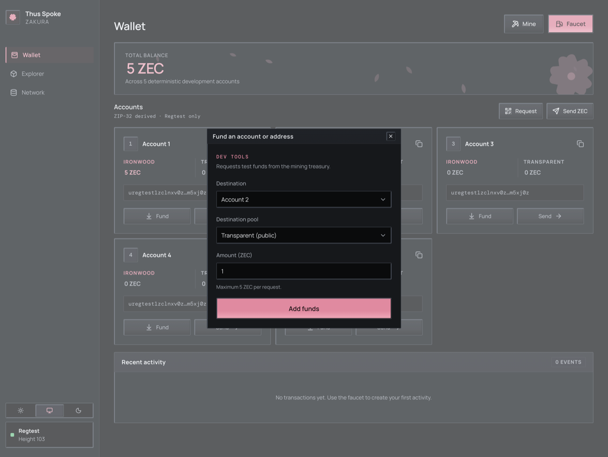
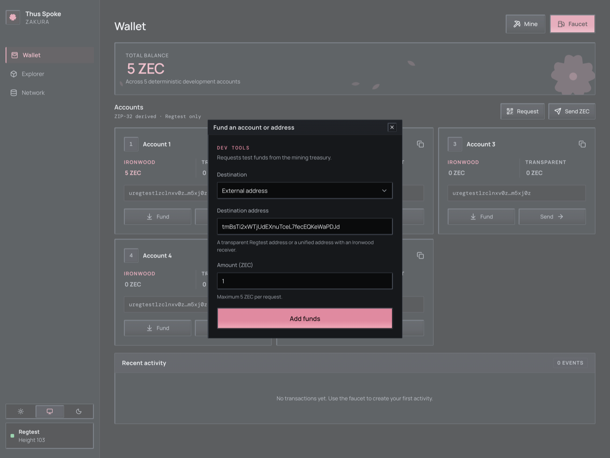
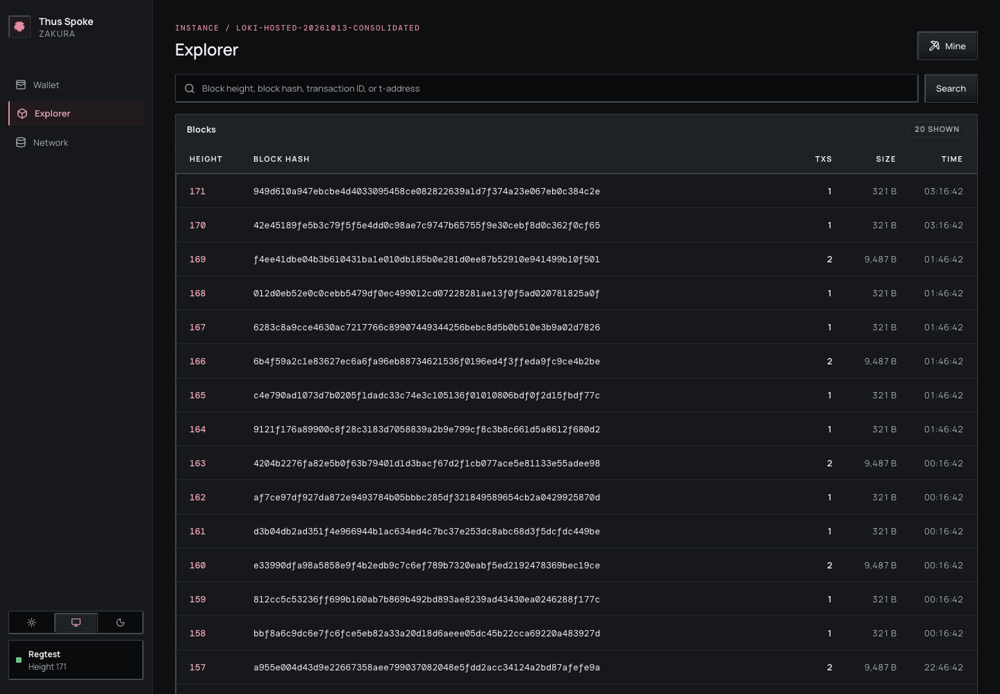
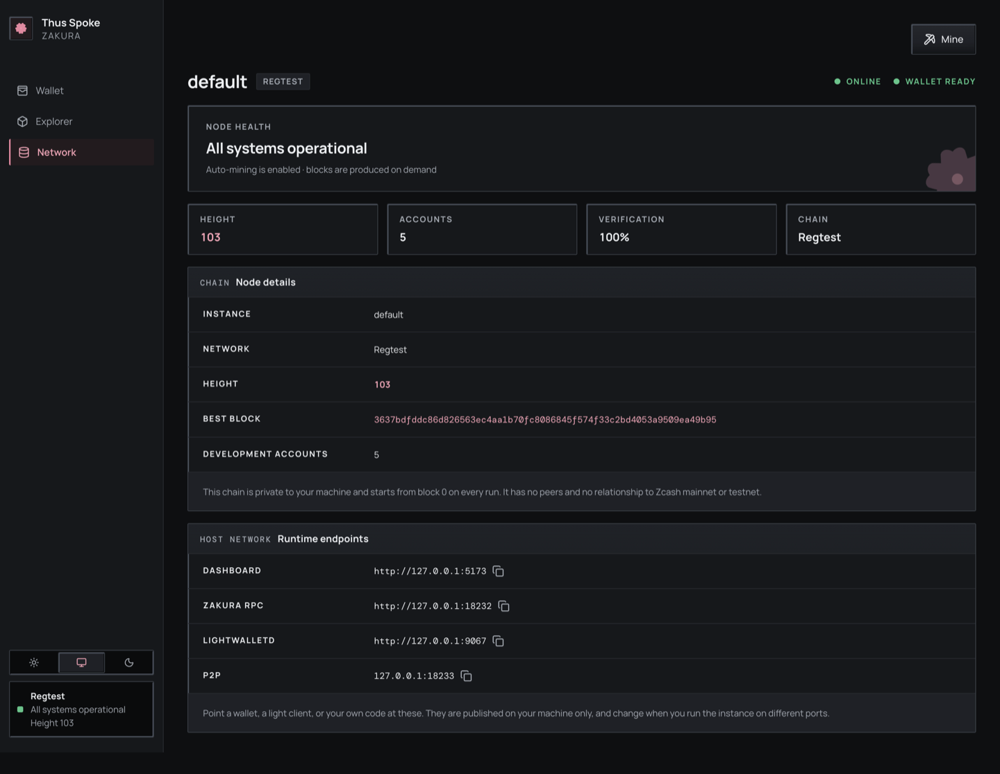

# 4. Fund and send

An account has separate transparent and Ironwood balances. The treasury funds
faucet requests. We will use the `default` instance from Chapter 1 to see both
in action. Keep `ths start --no-open` running in its first terminal; run the
commands below in a second terminal. If you stopped it, start it again for a
fresh chain with the same five accounts.

The dashboard has **Wallet**, **Explorer**, and **Network** pages. Use `ths
open` to bring it up. On desktop, the **Mine** button sits at the top of
each page; on a narrow screen you can always use `ths mine`.

## First, observe the starting state

Open **Wallet**. Account 1 should show **5 Ironwood ZEC** after startup;
Account 2 should have no funds. If balances have not appeared, inspect
`GET /api/v1/status` or follow [troubleshooting](troubleshooting.md) before
sending. The server wallet snapshot, not a browser calculation from chain
history, supplies these balances.


Select an account's name to open its detail page. The full unified address and
transparent address each have a copy button. The unified full viewing key is
also shown and copyable when the server supplies it; an older server that omits
the key simply has no viewing-key row. These pages cover development accounts
1–5 only.

Explorer also recognises those accounts. Searching the exact unified address of
a local account opens the same account page. Known transparent addresses in
transaction and address views have an **Account N** link beside their public
chain information. Unknown transparent addresses keep their normal Explorer
view; an unknown unified address still has no public chain-history page.
Viewing keys appear only on the account detail page, not in Explorer rows or
search results.

Two buttons open the faucet, and they are labelled differently. **Faucet**
in the page header is the general one, and it only appears on Wallet — the
Explorer and Network pages show just **Mine**. On each account card,
**Fund** opens the same dialog with that account preselected.

Recent activity ages update while the page is idle. This only refreshes the
displayed time; payment status still comes from the server.

## Fund Account 2's transparent pool

1. Select **Fund** on Account 2's card, or **Faucet** in the header.
2. In the **Fund an account or address** dialog, choose **Destination** Account 2,
   **Destination pool** Transparent, and **Amount (ZEC)** 1. Select
   **Add funds**.
3. Look at **Recent activity** for the transaction ID (`txid`), the unique
   identifier of the broadcast transaction, and its status. Once
   confirmed and the wallet snapshot catches up, Account 2's transparent
   balance should rise by 1 ZEC; its Ironwood balance is still separate.



The same operation from the second terminal is:

```console
ths wallet faucet --accounts 2 --amount 1 --pool transparent
```

Choose **either** the UI action or the CLI command if you want exactly one
faucet payment. Running both makes two payments. The faucet may mine extra
blocks first to mature and shield treasury rewards, then normally mines one
block to confirm the account payment. It accepts at most 5 ZEC **per account
per request**. If auto-mining fails, the recorded activity may remain
`broadcast`. [Chapter 6](architecture/operations.md)
compares these callers.

## Fund an external Regtest address

On Wallet, open **Faucet** and set **Destination** to **External address**.
Enter a transparent Regtest address or a unified Regtest address with an
Ironwood receiver, choose an amount of at most 5 ZEC, and select **Add funds**.
The dashboard checks the address with the server before submitting the
payment. If the response is lost, open **Payments** to resume the saved
request with the same idempotency key. Do not start a second request for the
same intended payment.



## Send Ironwood funds from Account 1 to Account 2

This is a **different** pool movement from the transparent faucet payment.

1. On Wallet, select **Send ZEC**.
2. Set **From account** to Account 1 and **Source pool** to Ironwood. Set
   **Destination** to Account 2 and **Destination pool** to Ironwood.
3. Enter **1** in **Amount (ZEC)**. Optionally enter `hello from Regtest`
   in **Memo (optional)**, then select **Send ZEC**.
4. Check Recent activity for the transaction ID and actual status. After
   confirmation and wallet settlement, Account 2 has 1 Ironwood ZEC **and**
   its earlier 1 transparent ZEC. Account 1's Ironwood balance falls by 1 ZEC
   **plus the fee**; do not expect it to be exactly 4 ZEC.

The dialog does the fee arithmetic for you. As soon as it has an account and
a pool it asks `POST /api/v1/send/quote`, and the hint under the amount field
shows the quoted spendable amount and network fee for that account and pool.
The **Max** button fills in that spendable figure. An amount above it is rejected.
An amount above 21,000,000 ZEC, the maximum supply, is rejected before the
request is sent.

Closing Send while the fee check is pending cancels that submission. A payment
already submitted keeps running and remains available through **Payments**.


CLI equivalent:

```console
ths wallet send --from 1 --to 2 --amount 1 --memo "hello from Regtest"
```

Inspect the returned txid, status, and any confirming block hash, then the
accounts snapshot for the actual pool balances and source fee. Choose either
the UI action or the command for one intended payment.


1. **Pair 1 — where the money comes from.** The source account is one of
   1–5, and the source pool decides what is spent: `transparent` spends
   that account's UTXOs, `ironwood` spends its shielded notes.
2. **Pair 2 — what the receiver gets.** Choose a **Destination** account
   from 1–5, or select **Other address** and fill in **Destination address**.
   For an account, `ironwood` pays its unified address and `transparent` pays
   its t-address. The account may match the source when the pools differ.
   For **Other address**, use a transparent Regtest address or a unified
   Regtest address with an Ironwood receiver. The dialog chooses
   **Destination pool** from the address and the server validates it before
   sending.
3. **The fee is on top of the amount**, taken from the source account. That
   is why `max_zatoshi` from the quote, not the balance, is the ceiling.
4. **A transparent source rarely spends exactly.** Transparent inputs must
   be spent whole, so the change comes back as an Ironwood note in the source
   account rather than as transparent change.
5. **Only an Ironwood destination carries a memo.** A transparent output has
   no memo field at all.

The memo is encrypted to the recipient and limited to **512 UTF-8 bytes**,
not 512 characters. The UI disables the field for Transparent destinations;
the server rejects a present memo there too.

The server stores the supplied memo in its idempotency record to compare
replayed requests. An absent memo and an explicit empty text memo are different
payment identities. Activity has no memo field, and the dashboard's transaction views do not
decrypt received memos. ZIP-321 parsing can return a memo supplied in its input;
that does not read a memo from the chain.

`GET /api/v1/accounts` provides a `unified_full_viewing_key` for each user
account. An external wallet imported with that key can decrypt memos sent to
that account. Public Explorer data reveals neither memo plaintext nor private
Ironwood recipient addresses.

## Create a request for another sender

- On Wallet, select **Request** to open **Request ZEC**.
- Choose **Receiving account**, optionally enter **Amount (ZEC, optional)** and a memo, then select **Generate request**.

This calls `POST /api/v1/zip321/request` and displays a
copyable URI and QR code for that account's unified address.

A blank amount lets the sender choose; this generates a request and moves no funds.
Editing any field hides the generated URI and QR code while the values differ
from those used to generate them. Restoring the same values shows the result
again without regenerating. To create a request with different values, select
**Generate request** again. Memos use the same 512-byte text limit.
The memo encoded in the URI or QR code is readable
to anyone holding the request; transaction memo encryption occurs only when
an actual Ironwood payment is made. Generation does not read received
transaction memos.


## Payment request

Paste a single-payment `zcash:` URI into **Payment request
(optional)** and select **Apply**. The server resolves its address, pool,
optional amount, and text memo. Supply the amount when the request omits it.
Editing the URI disables Send until that revision is applied or the field is
cleared; a stale parse result cannot authorize the edited request. Editing the
transfer fields while Apply is pending also discards that result. Apply again
to replace the draft, or clear the request to continue with manual edits.


## A pool conversion to try next

If you want to see a transparent source fund an Ironwood destination, use the
transparent funds in Account 2:

```console
ths wallet shield --from 2 --to 2 --amount 0.5
```

This sends 0.5 ZEC to Account 2's Ironwood pool within the same account. The SDK selects
transparent inputs and pays a fee. Its change strategy can return any
remaining value to the **source account's Ironwood pool**, so Account 2's
transparent balance need not simply drop by 0.5 ZEC. Inspect both pools
afterward. The reverse operation is `ths wallet unshield --from 2 --to 2
--amount 0.2`. Both are allowed because the pools differ; a same-account
send with the same source and destination pool is rejected. See the [CLI reference](cli.md#ths-wallet-the-development-wallet)
for all pool options.

## Look at the chain without confusing it with the wallet

**Explorer** lists blocks and can search a height, block hash, transaction
ID, or transparent address. Open your transaction ID from Recent activity.
Transparent inputs and outputs are public chain data; Ironwood details are
not exposed as the user-account transfer shown by Recent activity. The
server's activity record knows the development account IDs, while the
Explorer follows the public chain.

The **Pending transactions** panel lists transactions the node has received but
has not yet included in a block. It appears only while at least one is
waiting, and refreshes automatically, including when an external app
broadcasts without advancing the chain. Open a transaction ID to
inspect it before mining. **Mine 1 block** opens the existing mining controls
with one block selected; confirm there to start the job. Once a transaction is
mined, it leaves the pending list, and the panel disappears when nothing is
left. A failed read shows an error instead of hiding the panel.



**Network** shows the node height, tip hash, account count, and published
endpoints. If a transaction is recorded but the wallet balance has not
caught up, follow the next chapter rather than computing a balance from
Explorer.



**What you learned:** a payment chooses **two account/pool pairs**, and
confirmation, activity, and wallet balance are related but separate
observations. **Next:** [mine a block and trace wallet
synchronization](mining-and-sync.md).
